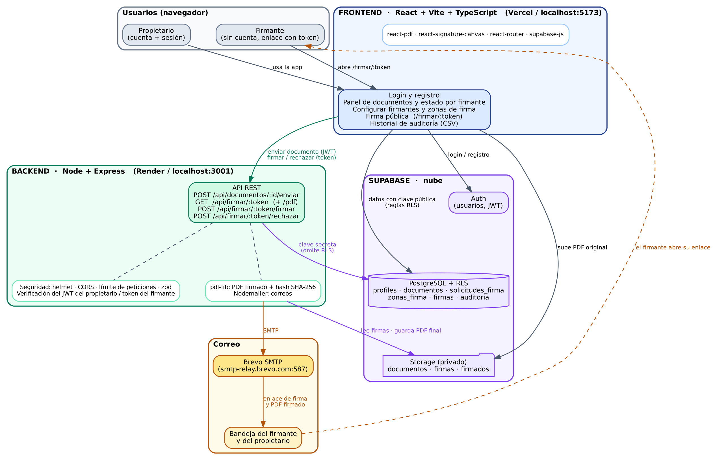
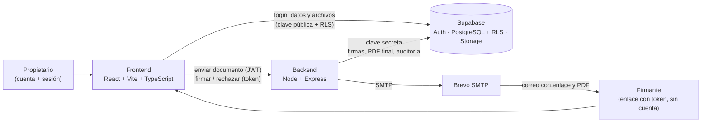

# SignApp

Plataforma web para **firmar documentos PDF**. El propietario sube el documento, invita a los firmantes por correo y marca **en qué lugar exacto** firmará cada uno. Cada firmante recibe un enlace personal, sin crear cuenta, y solo puede firmar dentro de la zona que se le asignó, dibujando su firma o subiendo una imagen. Al firmar todos, se genera el PDF final con su huella SHA-256 y un historial de auditoría.

## Funcionalidades

- Registro e inicio de sesión (Supabase Auth).
- Subida de PDF (máx. 10 MB) con cálculo del hash SHA-256 del original.
- El propietario define los firmantes y dibuja las **zonas de firma** sobre el PDF; después las bloquea al enviar.
- Enlace personal por firmante (token único), sin cuenta. Firma dibujada en lienzo o imagen PNG/JPG (máx. 2 MB).
- Rechazo del documento con motivo obligatorio.
- Estado por firmante en el panel del propietario (firmado, pendiente, rechazado).
- PDF final con las firmas incrustadas, escaladas dentro de su zona, y su propio hash.
- Historial de auditoría por documento, exportable a CSV.
- Correos reales por SMTP (Brevo). Sin credenciales, los correos se **simulan** en la terminal del backend.

## Arquitectura





**Cómo fluye:**

1. El propietario inicia sesión y sube un PDF. El navegador lo guarda en Supabase Storage (bucket `documentos`) y registra el documento.
2. Define firmantes y zonas. Al pulsar **Enviar**, el backend valida que cada firmante tenga zona, cambia el estado a `en_proceso` y envía un correo con el enlace de cada uno.
3. El firmante abre `/firmar/:token`. El backend solo le entrega **su** información y sus zonas; la posición de la firma nunca la decide el navegador.
4. Al firmar, el backend guarda la imagen, marca la solicitud y, si ya firmaron todos, genera el PDF final (`pdf-lib`), calcula su hash, lo guarda en el bucket `firmados` y avisa por correo.
5. Cada paso queda en la tabla `auditoria`, que no permite modificar ni borrar registros.

## Tecnologías

| Capa | Tecnología |
|---|---|
| Frontend | React, Vite, TypeScript, react-router, react-pdf, react-signature-canvas |
| Backend | Node.js, Express, TypeScript (tsx), zod, helmet, express-rate-limit, pdf-lib, Nodemailer |
| Base de datos y archivos | Supabase (PostgreSQL con RLS, Auth y Storage) |
| Correo | Brevo (SMTP) |
| Despliegue previsto | Vercel (frontend), Render (backend) |

## Estructura del proyecto

```
signapp/
├── backend/                  API (Node + Express)
│   ├── src/
│   │   ├── index.ts          arranque, CORS, límites de peticiones
│   │   ├── supabase.ts       cliente con la clave secreta
│   │   ├── autenticacion.ts  verifica el JWT del propietario
│   │   ├── correo.ts         envío de correos (real o simulado)
│   │   ├── pdf.ts            PDF final y hash SHA-256
│   │   └── rutas/            documentos.ts · firmar.ts
│   └── .env.example
├── frontend/                 Aplicación web (React + Vite)
│   ├── src/
│   │   ├── lib/supabase.ts
│   │   ├── context/AuthContext.tsx
│   │   └── pages/            Auth · Dashboard · ConfigurarFirmantes · FirmarPublico · Auditoria
│   └── .env.example
├── database/                 Scripts SQL para Supabase
│   ├── signapp_schema.sql
│   └── signapp_migracion_zonas.sql
└── docs/
    └── arquitectura.png
```

## Guía de instalación (computador nuevo)

### 1. Requisitos

- **Node.js 20 o superior** (probado con 22 y 24) y npm. Comprueba con `node -v`.
- **Git**.
- Una cuenta gratuita en **[Supabase](https://supabase.com)**.
- *(Opcional, para correos reales)* una cuenta gratuita en **[Brevo](https://www.brevo.com)**.

> Los comandos están escritos para Linux y macOS. En Windows usa PowerShell y cambia `cp` por `Copy-Item`.

### 2. Clonar el repositorio

```bash
git clone https://github.com/ramirezhernandezsebastian650-hash/signapp.git
cd signapp
```

El repositorio es privado: tu cuenta de GitHub debe tener acceso como colaborador. Si Git pide credenciales, inicia sesión con `gh auth login` (GitHub CLI) o usa un token personal.

### 3. Crear el proyecto en Supabase

1. En Supabase crea un proyecto nuevo (por ejemplo `signapp`) y guarda la contraseña de la base de datos.
2. Abre **SQL Editor** → **New query**, pega el contenido de `database/signapp_schema.sql` y pulsa **Run**. Debe responder *Success. No rows returned*.
3. Haz lo mismo con `database/signapp_migracion_zonas.sql`. **Ejecuta cada script una sola vez y en este orden.**
4. En **Authentication → Sign In / Providers → Email**, desactiva **Confirm email** mientras desarrollas.
5. En **Authentication → URL Configuration**, pon `http://localhost:5173` como **Site URL**.
6. En **Connect → API Keys** (o **Project Settings → API**) copia:
   - la **Project URL**,
   - la clave **publishable** (para el frontend),
   - la clave **secret** (solo para el backend).

Tras ejecutar los scripts deben existir las tablas `profiles`, `documentos`, `solicitudes_firma`, `zonas_firma`, `firmas` y `auditoria`, y los buckets privados `documentos`, `firmas` y `firmados`.

> Los proyectos gratuitos de Supabase se **pausan tras una semana sin uso**. Si la aplicación deja de conectar, reactívalo desde su panel.

### 4. Configurar y arrancar el backend

```bash
cd backend
npm install
cp .env.example .env
```

Edita `backend/.env`:

```
PORT=3001
FRONTEND_URL=http://localhost:5173
SUPABASE_URL=https://TU-PROYECTO.supabase.co
SUPABASE_SECRET_KEY=la_clave_secret
SMTP_USER=
SMTP_PASS=
```

Con `SMTP_USER` y `SMTP_PASS` vacíos, los correos se **simulan**: el enlace de cada firmante aparece en la terminal del backend, lo que basta para probar todo en local.

```bash
npm run dev
```

Debe imprimir `API escuchando en http://localhost:3001`. Compruébalo con `curl http://localhost:3001/api/salud`, que responde `{"ok":true}`.

### 5. Configurar y arrancar el frontend

En otra terminal:

```bash
cd frontend
npm install
cp .env.example .env.local
```

Edita `frontend/.env.local`:

```
VITE_SUPABASE_URL=https://TU-PROYECTO.supabase.co
VITE_SUPABASE_PUBLISHABLE_KEY=la_clave_publishable
VITE_API_URL=http://localhost:3001
```

```bash
npm run dev
```

Abre **http://localhost:5173**. Vite solo lee `.env.local` al arrancar: si lo cambias, reinicia el servidor.

### 6. Probar el flujo completo

1. Regístrate en `/login` y sube un PDF.
2. Pulsa **Configurar firmantes**, añade uno o más correos y arrastra sobre el PDF para marcar la zona de cada uno.
3. Pulsa **Enviar para firma**. Los enlaces `/firmar/...` aparecen en la terminal del backend (o llegan por correo si configuraste el SMTP).
4. Abre cada enlace en una **ventana privada** y firma dibujando o subiendo una imagen.
5. Al firmar el último, el documento pasa a `firmado` y el botón **Firmado** abre el PDF final. **Historial** muestra la auditoría con las huellas.

### 7. Correos reales (opcional)

1. En Brevo crea una cuenta gratuita (300 correos al día) y verifica un remitente en **Senders**.
2. En **SMTP & API → SMTP** copia el **Login** y genera una **clave SMTP**.
3. Agrega a `backend/.env`:

   ```
   SMTP_HOST=smtp-relay.brevo.com
   SMTP_PORT=587
   SMTP_USER=el_login_de_brevo
   SMTP_PASS=la_clave_smtp
   SMTP_FROM=tu_remitente_verificado@ejemplo.com
   ```

4. Reinicia el backend. Debe imprimir `Correo: conexión SMTP lista`.

Mientras `FRONTEND_URL` sea `localhost`, los enlaces de los correos solo abren en tu computador. Para que otras personas firmen desde su casa hay que desplegar la aplicación.

## Solución de problemas

| Síntoma | Causa y solución |
|---|---|
| Vite arranca en el puerto **5174** | Hay otro Vite abierto. Ciérralo (`pkill -f vite`). El backend solo acepta peticiones desde el origen de `FRONTEND_URL`. |
| `Invalid API key` o `Failed to fetch` | Revisa `frontend/.env.local` y reinicia Vite. |
| Errores de CORS en el navegador | `FRONTEND_URL` debe coincidir exactamente con la dirección del frontend, puerto incluido. |
| La app no conecta con la base de datos | Supabase pausó el proyecto por inactividad: reactívalo en su panel. |
| `Correo: sin credenciales SMTP` | Es normal si no configuraste Brevo: los correos se imprimen en la terminal. |
| SMTP `535 Authentication failed` | El login SMTP o la clave no coinciden con los del panel de Brevo (el login **no** es la clave). |
| SMTP `525 Unauthorized IP address` | Brevo bloquea IPs desconocidas: autoriza la tuya en **Settings → Security → Authorized IPs**. |
| El script SQL falla al repetirlo | Ya se había ejecutado: los tipos y tablas existen. Ejecuta cada script una sola vez. |

## Seguridad

- **Nunca subas** `backend/.env` ni `frontend/.env.local`: contienen claves y están excluidos por `.gitignore`. Solo se versionan los `.env.example`.
- La clave **secret** de Supabase omite todas las reglas de seguridad: vive únicamente en el backend.
- Los buckets son privados y la base de datos usa RLS; las firmas, el PDF final y la auditoría solo los escribe el backend.
- Si una clave se expone por accidente, revócala y genera una nueva.

## Equipo y flujo de trabajo

Proyecto desarrollado por **Sebastián Ramírez** (`ramirezhernandezsebastian650-hash`) y **José** (`josemo2921`).

- Rama `main`: versión estable.
- Cada integrante trabaja en su rama (`sebastian`, `jose`) y fusiona en `main` mediante *Pull Request*.
